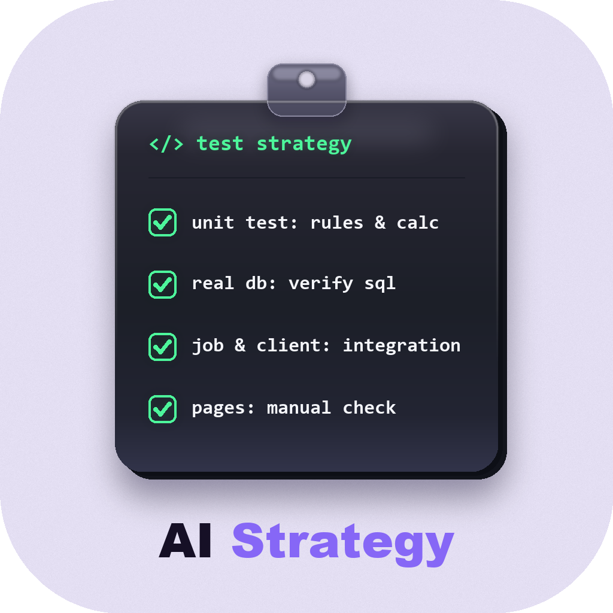

# test-strategy



分析项目或模块**真正还需要做哪些测试**：哪些单测就够、哪些必须到真库验 SQL、哪些要联调 Job / 外部服务、哪些页面手工顺手点掉，产出带前置数据与操作步骤的测试策略报告。本仓库是给 AI Agent 读的规则，不是测试执行框架。

面向 **Java Spring + MyBatis-Plus** 后端项目设计；其他技术栈可用，`references/whitebox-recon.md` 末尾有关键字映射表（JPA / GORM / Django / SQLAlchemy / Prisma 等）。

装好后对 Agent 说「出个测试策略」「还需要做哪些测试」「要不要做接口测试」「哪些用单测哪些用手工」「接下来怎么开始测」即可。Agent 会先让你选评估范围，再按 `SKILL.md` 与 `references/report-template.md` 生成测试策略文档。

## 核心思路：三层取舍，不硬凑

| 层 | 测什么 | 首选手段 |
|---|---|---|
| **L1 规则与纯口径** | 公式计算、精度舍入、阶梯判定、状态拦截、组合与导入校验 | 单测（直接调计算类 / Service + Mock DAO） |
| **L2 真库与联调** | 手写 XML SQL、Java 层 Wrapper、软删与批量事务、Job / MQ / 外部 Client | 页面手工走主链路，个别情况写接口脚本 |
| **L3 纯人工与阻塞专项** | 真实文件往返、前端联动、确认弹窗、无实现-阻塞核查 | 页面人工测试 |

配套五条取舍尺子，典型结论如：规则层能单测的不重复写接口自动化；Controller 纯透传 + 规则层已有单测 = 不铺全量接口测试；单测把 DAO / Client 全 Mock 了，S4～S6 捞出的盲区必须一个不落进真库与联调清单。

**不硬凑，且不替用户编造预期结果。** 不需要做的测试直接判「不需要」并给原因，不照着接口文档把所有接口列一遍；列出的待测项只写清 **前置数据 → 操作步骤**，不根据代码反推预期结果（预期结果由测试时对照需求文档或用例自行判断）。

**不覆盖**：从 PRD 设计功能用例（用 `testcase-design`）、编写自动化单测代码（用 `testcase-to-unittest`）、单条 SQL 审查、代码评审、线上问题排查。细则以 `SKILL.md` 为准。

## 安装

```bash
npx skills add zouaiyong/test-strategy
```

会装到 `~/.agents/skills/test-strategy`。直接读该目录的客户端（ZCode、Cursor 等）新开一轮对话即可被发现；WorkBuddy、Claude Code 不读这个目录，装完后让对应 Agent 把该路径软链接到自己的 skills 目录（WorkBuddy：`~/.workbuddy/skills/test-strategy`；Claude Code：`~/.claude/skills/test-strategy`）。Windows 建不了软链接就用目录联接。

也可以把本仓库直接放到上述目录。目录里必须有 `SKILL.md`。

## 使用

把被测代码所在的项目交给 Agent（可附带 Swagger / Knife4j / OpenAPI 接口文档或 `*-自动化覆盖矩阵.md`），并指定一种评估范围：

1. **仅评估当前分支改动**（常用）：对比主干分支（`origin/master` 或 `origin/main`）的增量与公共代码调用波及面，剔除零波及的老模块
2. **评估全量代码**：扫描整个仓库所有模块，适合新项目整体提测或老项目全盘摸底

没说评估范围时 Agent 会先弹窗询问，不会擅自开扫；无交互环境下默认按分支模式并在报告首行标注。没给接口文档或功能用例时，Agent 直接读本地 `Controller` 与源码，不会停步向你索要文档。

已有姊妹 skill 产物（`*-自动化覆盖矩阵.md`、`*-单测报告.md`）时，会从覆盖矩阵「手工与阻塞部分」分表和「自动化部分」半自动化 TC 的备注列两处捞缺口，把剩余工作分流到人工层与集成层；单测已红的判据偏差（记在 `*-单测报告.md` 第 6 节失败定位，不另建清单）会列为第一优先项（先找开发改代码，不算新测试）。还没写单测时，会从源码中挑出建议优先补单测的核心类与方法。

默认写到被测项目的 `doc/testcases/{项目或模块}-测试策略.md`（分支模式建议带分支名）。指定了目录就写到该目录。

**源码不全时**：个别模块本地没拉到代码会标注「无法做单测与 SQL 白盒分析」，只按线上 Swagger 给黑盒验证项；完全只有接口文档或 PRD 时会直接告知无法判断 Controller 厚度与 SQL 盲区，只能黑盒（或转 `testcase-design`），不会杜撰源码级发现。

## 交付物

报告固定 7 节，完整模板见 [references/report-template.md](references/report-template.md)：

`§1 评估结论与测试取舍` → `§2 现状与范围盘点` → `§3 核心业务场景验证（场景 1 ~ 场景 N）` → `§4 纯人工与阻塞专项（六大类）` → `§5 真库与外部联调必验清单（手写 SQL / 链式更新与条件拼接 / 软删重写与批量落库 / Job 与 Client）` → `§6 规则与纯口径单测` → `§7 下一步行动顺序`。

随 `§3 核心业务场景` 顺手触发的页面项或真库盲区，只在 `§3` 写一次页面点击步骤，`§4 / §5` 引用对应 `场景 X` 编号并只写增量核对点，不重复抄写同一套操作。

## 仓库结构

```text
.
├── SKILL.md                        # Agent 入口：选范围、S0~S6 目的表、三层模型与五条取舍尺子、自检清单
├── references/
│   ├── whitebox-recon.md           # S0~S6 操作细则、L3 六大类识别字典、技术栈映射表
│   └── report-template.md          # 报告 §1~§7 落盘模板
├── assets/                         # skill 图标（1024x1024，圆角透明底）
└── evals/
    ├── evals.json                  # 3 条评测提示词与 expectations
    ├── trigger-eval.json           # 20 条触发/不触发查询
    ├── README.md                   # 怎么跑一轮评测
    └── fixtures/
        ├── ANSWER-KEY.md           # fixture 埋了什么、报告必须抓到什么
        └── storage-fee-demo/       # 只读源码骨架（无单测、无用例），埋有 4A/4B/4C/Job/Client 样本
```

编号约定：`§N` 报告节、`SN` 摸底步、`L1/L2/L3` 三层，三套编号在所有文件中统一使用，互不混用。

## 常见问题

**还没有写单测或功能用例能用吗？** 能。Agent 会直接扫描源码揪出高价值单测目标（算钱算量、精度进位、状态拦截、导入校验），并按 L3 六大类识别字典（真实文件、前端默认值、动态表单、终态置灰与确认弹窗、Tooltip/日志、无实现-阻塞）列出页面人工专项。

**没给 Swagger / 接口文档会卡住吗？** 不会。未提供线上接口文档时直接读本地 `Controller` 注解提取接口；提供了线上文档则会额外比对本地与线上的接口漂移（如提示测试环境尚未部署最新代码）。

**为什么很多接口不建议写接口自动化？** 算钱算量与复杂校验下沉到单测几秒跑完且幂等；纯透传 Controller 的内部管理后台接口直接走页面手工主链路就能连路由、JSON 序列化、真库 SQL 一起验完，不重复造接口脚本。仅 5 种情况建议接口测试：拿不到源码、页面卡死、无页面入口的后台接口/Job、接口给外部系统调用、高频发版需固化回归脚本。

**只有接口文档、拿不到源码怎么办？** 完全无源码时无法判断 Controller 厚度与 SQL 盲区，单测层为 0，只能按接口契约 + 页面走黑盒，或转 `testcase-design` 写用例；Agent 不会杜撰源码级发现。

**不是 Java / MyBatis-Plus 项目怎么办？** 判断逻辑（手写 SQL、复杂查询条件、置空更新、软删唯一键、批量事务、非 HTTP 入口、外部依赖）与技术栈无关，`references/whitebox-recon.md` 第三节的映射表给了 JPA / GORM / Django / SQLAlchemy / Prisma 等的等价关键字，关键字不同但判断逻辑相同。
